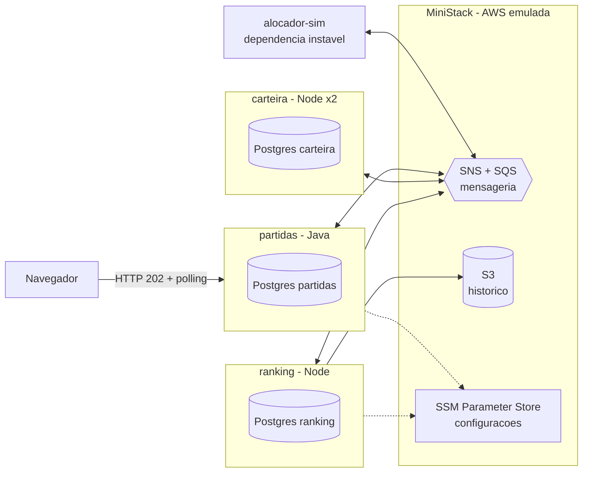
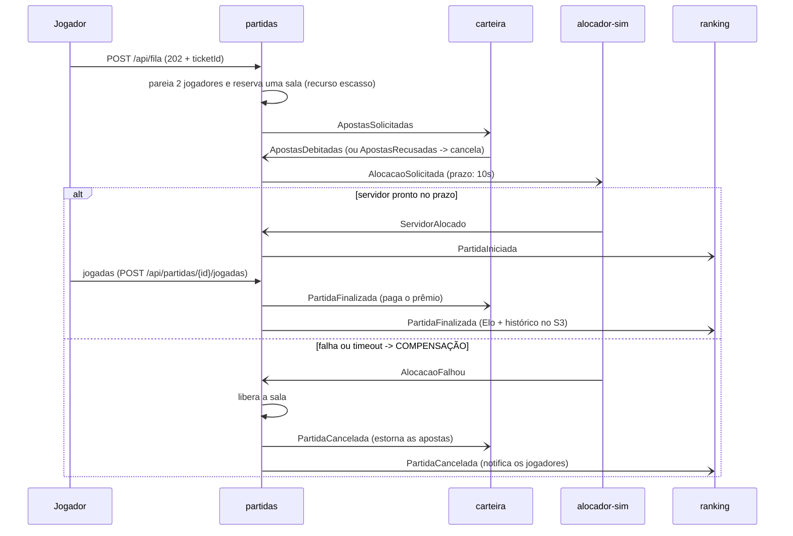

# Xadrez Distribuído

Trabalho final de Sistemas Distribuídos (FURB). Partidas de xadrez multiplayer **ranqueadas e valendo moedas**.
O motor de xadrez é o do meu projeto pessoal (pacotes `boardgame` e `chess`). Em volta dele há um sistema distribuído:
3 microsserviços em 2 linguagens que se coordenam por eventos (SNS + SQS) e usam serviços AWS emulados pelo MiniStack.

| Serviço | Linguagem | Banco | Responsabilidade |
|---|---|---|---|
| **partidas** | Java 21 / Spring Boot | Postgres `db-partidas` | Fila (matchmaking), salas, regras e jogadas, orquestração da saga |
| **carteira** | Node.js 22 | Postgres `db-carteira` | Saldo, débito das apostas, estornos (compensação) e prêmios. Roda com 2 réplicas |
| **ranking** | Node.js 22 | Postgres `db-ranking` + S3 | Elo, notificações e histórico das partidas no S3 |
| alocador-sim | Node.js | (memória) | **Dependência instável simulada**: "provedor de servidores de jogo" (não conta como microsserviço) |

## Como rodar

Pré-requisito: Docker com Docker Compose (Docker Desktop, ou Docker Engine no WSL2 do Windows).

Para jogar a partir de outras máquinas da rede, siga o passo a passo em [`docs/Xadrez-Distribuido-Jogar-na-Rede.pdf`](docs/Xadrez-Distribuido-Jogar-na-Rede.pdf).

```bash
docker compose up --build
```

O primeiro build baixa o Maven e as dependências do npm, então demora alguns minutos. Quando terminar:

- Jogo: <http://localhost:8080/?jogador=ana>. Abra outra aba com `?jogador=bia` e coloque os dois na fila com a mesma aposta.
- Carteira: <http://localhost:3001/carteiras/ana> · Ranking: <http://localhost:3010/ranking> · Alocador: <http://localhost:3020>
- Health checks: `/health` em cada serviço

Para testar o fluxo inteiro sem abrir o navegador, use `scripts/jogar-partida-rapida.sh` (ele joga um mate do pastor).

Os scripts de `scripts/` são bash. No Windows, rode no **Git Bash**, a partir da raiz do projeto.

## Arquitetura



### Fluxo principal (saga orquestrada pelo serviço partidas)



Onde estão os três elementos que o tema precisa ter:

1. **Transação distribuída com compensação.** A partida atravessa partidas, carteira e alocador. Se a alocação falhar ou passar do prazo, a sala é liberada e a carteira devolve as apostas (`PartidaCancelada`).
2. **Dependência lenta ou instável.** O `alocador-sim` tem latência e taxa de falha configuradas por `LATENCIA_MS`, `JITTER_MS` e `TAXA_FALHA`.
3. **Evento com vários interessados.** `PartidaFinalizada` e `PartidaCancelada` são publicados uma vez e consumidos pela carteira e pelo ranking.

Os contratos das mensagens estão em [`contracts/`](contracts/): JSON Schema, com o envelope `messageId, correlationId, type, version, occurredAt, payload`.

## Requisitos de sistemas distribuídos (onde estão no código)

| # | Requisito | Onde |
|---|---|---|
| R1 | At-least-once com idempotência | `processed_messages` gravada na mesma transação do efeito: `ProcessadorMensagens.java` e `node-common/index.js` (`iniciarConsumidor`). Na carteira, a tabela `lancamentos` tem também `UNIQUE (partida_id, jogador_id, tipo)` |
| R2 | Controle de concorrência | Reserva de sala com `UPDATE ... WHERE id = (SELECT ... FOR UPDATE SKIP LOCKED)` e `salas.partida_id UNIQUE` (`Matchmaker.java`). Índice único parcial impede um jogador em duas partidas. Na carteira, `SELECT ... FOR UPDATE` em ordem fixa e `CHECK (saldo >= 0)`. Jogadas simultâneas na mesma partida são serializadas por `FOR UPDATE` |
| R3 | API assíncrona | `POST /api/fila` responde `202 Accepted` com `ticketId`; o cliente consulta `GET /api/fila/{id}` (`FilaController.java`) |
| R4 | Consumidores concorrentes | `carteira` com `replicas: 2` na fila `carteira-eventos` (`docker-compose.yml`). Ordenação: veja abaixo |
| R5 | Dependência instável simulada | `alocador-sim`: `LATENCIA_MS`, `JITTER_MS`, `TAXA_FALHA` |
| R6 | Reconexão | Os loops de consumo e o relay do outbox capturam qualquer erro do broker e tentam de novo com backoff, sem reiniciar (`SqsConsumer.java`, `OutboxRelay.java`, `node-common`) |

Padrões usados: **transactional outbox** (o evento é gravado na mesma transação do estado e publicado depois, então nada se perde se o broker cair) e **saga orquestrada** com máquina de estados. Cada transição confere o estado atual, então eventos repetidos, atrasados ou fora de ordem são ignorados com segurança.

### Ordenação (R4)

As filas SQS são *standard*: entregam pelo menos uma vez e **sem garantia de ordem**. Isso funciona porque:

- Cada saga tem uma única mensagem "em voo" por vez: o próximo passo só é publicado depois que o anterior foi processado. Não há duas mensagens da mesma partida competindo na fila.
- O orquestrador valida o estado antes de cada transição. Um `ServidorAlocado` que chega depois do cancelamento não reabre a partida: ele dispara a liberação do servidor (F7).
- As jogadas **não** passam pela fila. Elas são chamadas síncronas serializadas por lock na linha da partida, e o número da jogada (`PRIMARY KEY (partida_id, numero)`) garante a ordem.
- Se um dia fosse preciso publicar cada jogada (para espectadores, por exemplo), a escolha seria SQS FIFO com `MessageGroupId = partidaId`: ordem garantida dentro de cada partida e paralelismo entre partidas diferentes.

## Serviços de nuvem e por que eles

| Categoria | Serviço | Por quê (e não a alternativa) |
|---|---|---|
| Mensageria | **SNS + SQS** | O SNS faz o fan-out de um evento para vários serviços. O SQS dá a cada serviço uma fila própria, com reentrega, visibility timeout e DLQ nativos. Não precisa operar um broker (RabbitMQ/Kafka), e o Kafka seria exagero para o volume e não tem DLQ pronta |
| Armazenamento de objetos | **S3** | O histórico de cada partida é um documento imutável, escrito uma vez e lido raramente. Guardar no S3 é mais barato e não incha o banco relacional |
| Segredos e configurações | **SSM Parameter Store** | Timeout de alocação e fator K do Elo mudam sem rebuild. O Secrets Manager cobra por segredo e só faria sentido para credenciais |

Os bancos são Postgres em contêiner, um por serviço (nenhum serviço acessa o banco do outro). Escolhi Postgres por causa das transações ACID e de `FOR UPDATE SKIP LOCKED`, que são a base do R1 e do R2. Na AWS, cada um viraria uma instância RDS sem mudar o código.

Endpoints, credenciais e nomes de filas vêm de variáveis de ambiente (`AWS_ENDPOINT_URL`, `QUEUE_NAME` etc.). Sem `AWS_ENDPOINT_URL`, o mesmo código fala com a AWS real. Toda a infraestrutura é criada pelo script versionado [`infra/init.sh`](infra/init.sh), que roda sozinho no `docker compose up` e é idempotente.

## Cenários de falha (demonstração)

| # | Script | O que mostra |
|---|---|---|
| F1 | `scripts/f1-compensacao.sh` | `TAXA_FALHA=1`: aposta debitada e estornada, sala liberada, notificação ao jogador |
| F2 | `scripts/f2-servico-morre.sh` | `docker kill` na réplica da carteira no meio do débito. A outra réplica aplica o efeito uma vez |
| F3 | `scripts/f3-duplicada.sh` | Mesma mensagem (mesmo `messageId`) publicada 5 vezes: o prêmio é pago uma vez |
| F4 | `scripts/f4-venenosa.sh` | Payload inválido: 3 tentativas, depois DLQ; uma partida normal segue funcionando |
| F5 | `scripts/f5-corrida.sh` | 100 jogadores para 10 salas: exatamente 10 partidas, 80 recusados |
| F6 | `scripts/f6-broker-fora.sh` | MiniStack parado por 30s: o outbox acumula, os serviços reconectam e o outbox drena |
| F7 | `scripts/f7-resposta-tardia.sh` | Latência de 15s com prazo de 10s: cancela com estorno, e o servidor que chega atrasado é liberado |
| F8 | `scripts/f8-escala.sh` | 3 réplicas da carteira: carga dividida, zero efeitos duplicados |

Variáveis úteis (veja `.env.example`): `TAXA_FALHA`, `LATENCIA_MS`, `SALAS_TOTAL`, `CARTEIRA_REPLICAS`, `ATRASO_PROCESSAMENTO_MS`, `VISIBILITY_TIMEOUT`, `MAX_RECEIVE_COUNT`.

Para ver os logs de uma saga inteira, filtre pelo id da partida (é o `correlationId` de todas as mensagens):

```bash
docker compose logs -f | grep <partidaId>
```

### Leitura do F5

O enunciado fala em "100 requisições para 10 unidades, exatamente 10 sucessos". Aqui a unidade escassa é a **sala**, e cada sala recebe uma partida com 2 jogadores. Com 10 salas e 100 jogadores, o resultado esperado é **10 partidas criadas** (20 jogadores atendidos) e **80 tickets `RECUSADO` (`SEM_SALA_DISPONIVEL`)**. A garantia que importa é que nenhuma sala tenha duas partidas e nenhum jogador esteja em duas partidas, e o script confere as duas coisas.

## Falha surpresa: o que acontece se cada componente cair

Previsão para `docker kill <componente>` (ou `docker compose stop`). Com `docker kill`, os serviços voltam sozinhos (`restart: unless-stopped`). Com `stop`, é preciso dar `docker compose start`.

| Componente que cai | O que o usuário vê | O que acontece por dentro | Quando volta |
|---|---|---|---|
| **partidas** | A página e a API (porta 8080) param. Saldo e ranking continuam aparecendo, porque vêm de outros serviços | Mensagens para `partidas-eventos` ficam na fila. Nada se perde: o estado e as jogadas estão no banco | Consome a fila acumulada e publica o outbox pendente. A partida em andamento continua de onde parou, porque o tabuleiro é reconstruído pelas jogadas gravadas. Partidas que estavam em `ALOCANDO_SERVIDOR` com prazo vencido são canceladas com estorno, e um `ServidorAlocado` que chegar depois é tratado como resposta tardia (F7) |
| **carteira** (1 das 2 réplicas) | Nada | A outra réplica continua consumindo. Uma mensagem que estava sendo processada pela réplica morta volta para a fila depois do visibility timeout (15s) e é aplicada uma vez (F2) | Volta a dividir a carga |
| **carteira** (todas) | "carteira indisponível" no painel. Quem entrar na fila fica em "debitando apostas..." | `ApostasSolicitadas` fica parada em `carteira-eventos`. A partida fica em `PENDENTE_APOSTAS` (essa fase não tem prazo) | Debita as apostas e a saga segue normalmente. Estornos e prêmios pendentes também são aplicados |
| **ranking** | O jogo funciona. Notificações e ranking param de atualizar | Os eventos acumulam em `ranking-eventos`. A Carteira continua pagando prêmios (é outro consumidor do mesmo evento) | Processa tudo o que acumulou: Elo, notificações e histórico no S3 ficam em dia |
| **alocador-sim** | A partida pareada é cancelada depois de 10s e a aposta é devolvida | `AlocacaoSolicitada` fica na fila e o `Expirador` cancela por `TIMEOUT_ALOCACAO`, com compensação | Atende os pedidos antigos e aloca servidores para partidas já canceladas. O Partidas responde com `LiberacaoServidorSolicitada`, igual ao F7 |
| **ministack** (broker + S3 + SSM) | O jogo em andamento continua (as jogadas são HTTP + banco). Entrar na fila responde 202 e a partida é pareada, mas não avança | Os eventos ficam guardados no outbox de cada serviço. Os consumidores logam "tentando reconectar". Se uma partida estava esperando o alocador, ela expira e o `PartidaCancelada` fica no outbox | Os serviços reconectam sozinhos, o outbox drena e a saga continua. Estornos atrasados são aplicados (F6) |
| **db-partidas** | A API responde erro e `/health` mostra `DOWN` | O processamento das mensagens falha e elas não são apagadas | O pool reconecta sozinho e tudo volta a funcionar. **Limite:** se o banco ficar fora mais que ~45s (3 tentativas x 15s), as mensagens que chegaram nesse período vão para a DLQ |
| **db-carteira** / **db-ranking** | Mesmo efeito, no serviço correspondente | Mesmo efeito | Mesmo limite da DLQ |

**Limites conhecidos (bons para citar na defesa):**

- A fase `PENDENTE_APOSTAS` não tem prazo. Se a Carteira ficar fora por muito tempo, a partida espera. Melhoria possível: um prazo também para essa fase, cancelando sem estorno.
- Erro de infraestrutura (banco fora) conta como tentativa, assim como mensagem inválida. Depois do limite, a mensagem vai para a DLQ. Melhorias possíveis: aumentar `MAX_RECEIVE_COUNT`, ou só aceitar mensagens quando o banco estiver saudável. Uma mensagem que caiu na DLQ pode ser devolvida para a fila de origem depois de corrigida a causa.
- O Partidas roda com uma réplica, porque a página do jogo depende da porta 8080. O código já suporta mais réplicas: matchmaking, outbox e expiração usam `FOR UPDATE SKIP LOCKED`.

## Estrutura

```
contracts/      JSON Schema do envelope e de cada evento
infra/init.sh   cria filas, DLQs, tópicos, assinaturas, bucket e parâmetros
partidas/       serviço Java (inclui o motor de xadrez original em boardgame/ e chess/)
carteira/       serviço Node
ranking/        serviço Node
alocador-sim/   dependência instável simulada
node-common/    mensageria, outbox, idempotência e reconexão compartilhadas pelos serviços Node
scripts/        demonstrações F1-F8
```

## Mudanças no motor de xadrez original

- Corrigida a validação da peça de promoção (`replacePromotedPiece`), que aceitava qualquer letra.
- Adicionado `isStalemate()` para detectar afogamento (empate).
- A interface de console (`application/`) não foi trazida: o jogo agora é pela API e pela página web.
